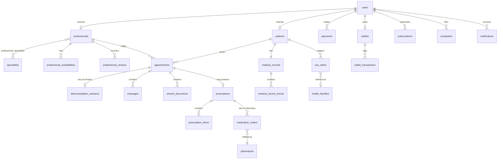

# Structure de base de données — Allo Docteur

Proposition de schéma relationnel (PostgreSQL) découpée en modules, à partir du cahier des charges. Types indicatifs (PostgreSQL) ; adaptable en JPA/Hibernate (Spring Boot) ou Doctrine (Symfony).

---

## 1. Module Utilisateurs & Authentification

### `users`
Table racine commune à tous les types de comptes (patients, professionnels, admins).

| Colonne | Type | Contraintes |
|---|---|---|
| id | UUID / BIGSERIAL | PK |
| email | VARCHAR(255) | UNIQUE, NOT NULL |
| phone | VARCHAR(20) | UNIQUE |
| password_hash | VARCHAR(255) | NOT NULL |
| role | ENUM('patient','professional','admin') | NOT NULL |
| first_name | VARCHAR(100) | |
| last_name | VARCHAR(100) | |
| photo_url | VARCHAR(255) | |
| two_factor_enabled | BOOLEAN | DEFAULT false |
| two_factor_secret | VARCHAR(255) | |
| consent_given_at | TIMESTAMP | consentement numérique patient |
| status | ENUM('active','suspended','pending') | DEFAULT 'pending' |
| created_at / updated_at | TIMESTAMP | |

### `patients`
| Colonne | Type | Contraintes |
|---|---|---|
| id | UUID | PK, FK → users.id |
| birth_date | DATE | |
| gender | ENUM('M','F','other') | |
| address | VARCHAR(255) | |
| city | VARCHAR(100) | |
| district | VARCHAR(100) | quartier |
| emergency_contact_name | VARCHAR(150) | |
| emergency_contact_phone | VARCHAR(20) | |
| is_premium | BOOLEAN | DEFAULT false |

### `professionals`
| Colonne | Type | Contraintes |
|---|---|---|
| id | UUID | PK, FK → users.id |
| qualification | VARCHAR(150) | |
| license_number | VARCHAR(100) | numéro d'ordre professionnel, UNIQUE |
| years_experience | INT | |
| bio | TEXT | |
| city | VARCHAR(100) | |
| district | VARCHAR(100) | |
| coverage_area | VARCHAR(255) | zone géographique d'intervention (ou table à part si multi-zones) |
| consultation_fee | NUMERIC(10,2) | tarif téléconsultation |
| home_visit_fee | NUMERIC(10,2) | tarif visite à domicile |
| is_verified | BOOLEAN | DEFAULT false |
| verification_document_url | VARCHAR(255) | |
| subscription_status | ENUM('trial','active','expired') | abonnement professionnel |
| created_at / updated_at | TIMESTAMP | |

### `professional_types`
Table de référence : médecin généraliste, spécialiste, infirmier, sage-femme, aide-soignant, kiné, psychologue, nutritionniste.

| Colonne | Type |
|---|---|
| id | SERIAL PK |
| code | VARCHAR(50) UNIQUE |
| label_fr | VARCHAR(100) |

`professionals.professional_type_id` → FK vers `professional_types`.

### `specialties`
| Colonne | Type |
|---|---|
| id | SERIAL PK |
| name | VARCHAR(100) |
| parent_specialty_id | FK nullable (auto-référence pour sous-spécialités) |

### `professional_specialties` (table pivot n-n)
| professional_id (FK) | specialty_id (FK) |

---

## 2. Disponibilités & recherche

### `professional_availabilities`
| Colonne | Type |
|---|---|
| id | PK |
| professional_id | FK |
| day_of_week | SMALLINT (0-6) ou date spécifique |
| start_time | TIME |
| end_time | TIME |
| is_recurring | BOOLEAN |
| specific_date | DATE (nullable, pour dispo ponctuelle) |
| is_available_for_teleconsultation | BOOLEAN |
| is_available_for_home_visit | BOOLEAN |

Index recommandés sur `professionals(city, district)`, `specialties(name)`, `professional_availabilities(day_of_week, start_time)` pour la recherche avancée.

### `professional_reviews`
| Colonne | Type |
|---|---|
| id | PK |
| professional_id | FK |
| patient_id | FK |
| appointment_id | FK (nullable, pour lier l'avis à une consultation réelle) |
| rating | SMALLINT (1-5) |
| comment | TEXT |
| created_at | TIMESTAMP |

---

## 3. Rendez-vous, téléconsultation & visites à domicile

### `appointments`
Table centrale unifiant téléconsultation et visite à domicile.

| Colonne | Type | Notes |
|---|---|---|
| id | PK | |
| patient_id | FK | |
| professional_id | FK | |
| type | ENUM('teleconsultation_video','teleconsultation_audio','chat','home_visit') | |
| reason_category | ENUM('consultation','treatment_followup','medical_certificate','injection','dressing','infusion','blood_pressure','medical_surveillance','pregnancy_followup','postnatal','breastfeeding_advice','elderly_assistance','hygiene_care','daily_companionship') | mappe les sous-services listés dans le cahier des charges |
| scheduled_at | TIMESTAMP | |
| status | ENUM('requested','confirmed','in_progress','completed','cancelled','no_show') | |
| address | VARCHAR(255) | requis si home_visit |
| latitude / longitude | NUMERIC | pour géolocalisation |
| fee | NUMERIC(10,2) | |
| created_at / updated_at | TIMESTAMP | |

### `teleconsultation_sessions`
| Colonne | Type |
|---|---|
| id | PK |
| appointment_id | FK UNIQUE |
| session_token / room_id | VARCHAR(255) |
| started_at / ended_at | TIMESTAMP |
| video_provider_ref | VARCHAR(255) (ex. ID Twilio/Agora) |

### `messages`
Messagerie instantanée entre patient et professionnel.

| Colonne | Type |
|---|---|
| id | PK |
| appointment_id | FK |
| sender_id | FK → users |
| content | TEXT |
| sent_at | TIMESTAMP |
| read_at | TIMESTAMP nullable |

### `shared_documents`
Partage d'images médicales / documents pendant une consultation.

| Colonne | Type |
|---|---|
| id | PK |
| appointment_id | FK |
| uploaded_by | FK → users |
| file_url | VARCHAR(255) |
| file_type | ENUM('image','pdf','other') |
| uploaded_at | TIMESTAMP |

---

## 4. Dossier médical & suivi

### `medical_records`
| Colonne | Type |
|---|---|
| id | PK |
| patient_id | FK UNIQUE |
| blood_type | VARCHAR(5) |
| allergies | TEXT |
| chronic_conditions | TEXT |
| created_at / updated_at | TIMESTAMP |

### `medical_record_entries`
Historique des consultations / carnet de santé numérique — une entrée par événement médical.

| Colonne | Type |
|---|---|
| id | PK |
| medical_record_id | FK |
| appointment_id | FK nullable |
| entry_type | ENUM('consultation','vaccination','lab_result','hospitalization','note') |
| description | TEXT |
| entry_date | DATE |
| created_by | FK → professionals nullable |

### `prescriptions`
| Colonne | Type |
|---|---|
| id | PK |
| appointment_id | FK |
| patient_id | FK |
| professional_id | FK |
| issued_at | TIMESTAMP |
| status | ENUM('issued','sent_to_pharmacy','fulfilled','expired') |
| qr_code / signature_ref | VARCHAR(255) — prescription électronique signée |

### `prescription_items`
| Colonne | Type |
|---|---|
| id | PK |
| prescription_id | FK |
| medication_name | VARCHAR(255) |
| dosage | VARCHAR(100) |
| duration | VARCHAR(100) |
| instructions | TEXT |

---

## 5. Urgences (SOS)

### `sos_alerts`
| Colonne | Type |
|---|---|
| id | PK |
| patient_id | FK |
| latitude / longitude | NUMERIC | géolocalisation au moment de l'alerte |
| status | ENUM('triggered','professional_contacted','redirected','visit_dispatched','resolved','cancelled') |
| contacted_professional_id | FK nullable |
| redirected_facility_id | FK nullable → `health_facilities` |
| triggered_at / resolved_at | TIMESTAMP |

### `health_facilities`
Structures sanitaires proches (pour l'orientation SOS et les partenaires).

| Colonne | Type |
|---|---|
| id | PK |
| name | VARCHAR(150) |
| type | ENUM('clinic','hospital','health_center') |
| city / district | VARCHAR(100) |
| latitude / longitude | NUMERIC |
| phone | VARCHAR(20) |

---

## 6. Pharmacie numérique

### `pharmacies`
| Colonne | Type |
|---|---|
| id | PK |
| name | VARCHAR(150) |
| address | VARCHAR(255) |
| city / district | VARCHAR(100) |
| latitude / longitude | NUMERIC |
| is_partner | BOOLEAN |
| phone | VARCHAR(20) |

### `medication_orders`
| Colonne | Type |
|---|---|
| id | PK |
| prescription_id | FK |
| pharmacy_id | FK |
| patient_id | FK |
| delivery_address | VARCHAR(255) |
| status | ENUM('pending','preparing','out_for_delivery','delivered','cancelled') |
| total_amount | NUMERIC(10,2) |
| created_at / delivered_at | TIMESTAMP |

---

## 7. Paiement

### `payments`
| Colonne | Type |
|---|---|
| id | PK |
| payable_type | ENUM('appointment','medication_order','subscription') | pattern polymorphe |
| payable_id | UUID/BIGINT | référence l'entité concernée |
| user_id | FK |
| amount | NUMERIC(10,2) |
| method | ENUM('mobile_money','card','bank_transfer','wallet') |
| provider_reference | VARCHAR(255) | ID transaction opérateur |
| status | ENUM('pending','completed','failed','refunded') |
| created_at | TIMESTAMP |

### `wallets`
Portefeuille électronique interne, si l'appli en propose un en plus des moyens externes.

| Colonne | Type |
|---|---|
| id | PK |
| user_id | FK UNIQUE |
| balance | NUMERIC(10,2) DEFAULT 0 |
| updated_at | TIMESTAMP |

### `wallet_transactions`
| Colonne | Type |
|---|---|
| id | PK |
| wallet_id | FK |
| type | ENUM('credit','debit') |
| amount | NUMERIC(10,2) |
| related_payment_id | FK nullable |
| created_at | TIMESTAMP |

### `subscriptions`
Abonnements professionnels et patients Premium.

| Colonne | Type |
|---|---|
| id | PK |
| user_id | FK |
| plan_type | ENUM('professional_standard','professional_premium','patient_premium') |
| start_date / end_date | DATE |
| status | ENUM('active','expired','cancelled') |
| price | NUMERIC(10,2) |

---

## 8. Partenaires, réclamations & administration

### `partners`
| Colonne | Type |
|---|---|
| id | PK |
| name | VARCHAR(150) |
| type | ENUM('clinic','health_center','hospital','pharmacy','lab','ambulance','insurance','mutual') |
| contact_email / contact_phone | VARCHAR |
| contract_start_date | DATE |
| status | ENUM('active','inactive') |

### `insurance_policies`
Pour les paiements pris en charge par assurance/mutuelle.

| Colonne | Type |
|---|---|
| id | PK |
| patient_id | FK |
| partner_id | FK → partners (assureur) |
| policy_number | VARCHAR(100) |
| coverage_rate | NUMERIC(5,2) | % pris en charge |
| valid_until | DATE |

### `complaints`
Réclamations.

| Colonne | Type |
|---|---|
| id | PK |
| user_id | FK |
| appointment_id | FK nullable |
| subject | VARCHAR(255) |
| description | TEXT |
| status | ENUM('open','in_review','resolved','rejected') |
| created_at / resolved_at | TIMESTAMP |

### `admin_audit_logs`
Pour la traçabilité des actions du tableau de bord admin.

| Colonne | Type |
|---|---|
| id | PK |
| admin_id | FK → users |
| action | VARCHAR(255) |
| target_type / target_id | VARCHAR / UUID |
| created_at | TIMESTAMP |

### `notifications`
| Colonne | Type |
|---|---|
| id | PK |
| user_id | FK |
| type | ENUM('appointment_reminder','payment','prescription','sos','complaint_update','system') |
| title | VARCHAR(255) |
| body | TEXT |
| is_read | BOOLEAN DEFAULT false |
| sent_via | ENUM('push','sms','email') |
| created_at | TIMESTAMP |

---

## Vue d'ensemble des relations clés

---

## Notes de conception

- **Héritage `users` → `patients`/`professionals`** : approche « table par sous-type » (Class Table Inheritance), adaptée à Hibernate (`@Inheritance(strategy = JOINED)`) ou Doctrine (`@InheritanceType("JOINED")`).
- **`appointments` unifié** : regrouper téléconsultation et visite à domicile dans une seule table évite la duplication de la logique de statut/paiement/avis ; le `type` et `reason_category` distinguent les cas d'usage détaillés du cahier des charges (injection, pansement, suivi de grossesse, etc.).
- **`payments.payable_type` / `payable_id`** : pattern polymorphe pour rattacher un paiement à un rendez-vous, une commande pharmacie ou un abonnement sans multiplier les tables de paiement.
- **Conformité santé** : prévoir chiffrement au niveau colonne (pgcrypto) pour `medical_records`, `medical_record_entries`, `prescriptions`, et journalisation d'accès (qui a consulté quel dossier, quand) — table `medical_record_access_logs` à ajouter si une traçabilité fine est exigée réglementairement.
- **Géolocalisation** : envisager l'extension PostGIS si des requêtes de proximité (patients ↔ professionnels ↔ pharmacies) doivent être performantes à l'échelle.
- **Index** : au minimum sur les colonnes de recherche avancée (`city`, `district`, `specialty`, `fee`, disponibilité) et sur les clés étrangères fréquemment jointes (`appointment_id`, `patient_id`, `professional_id`).
